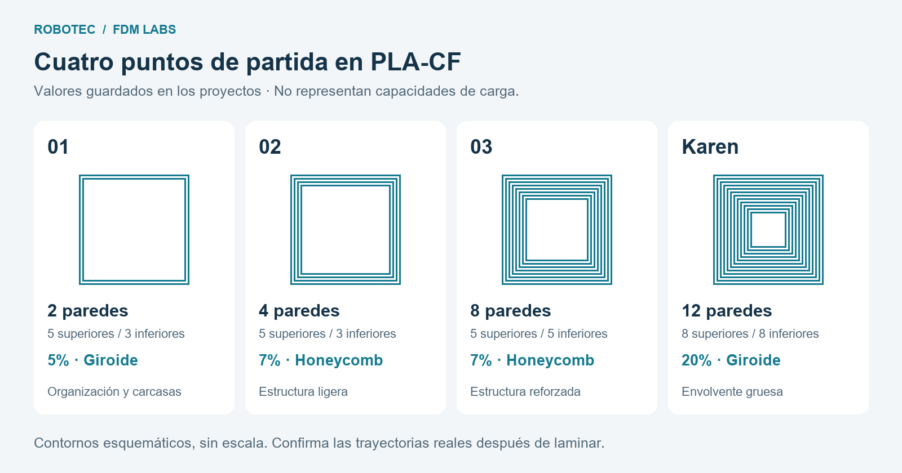
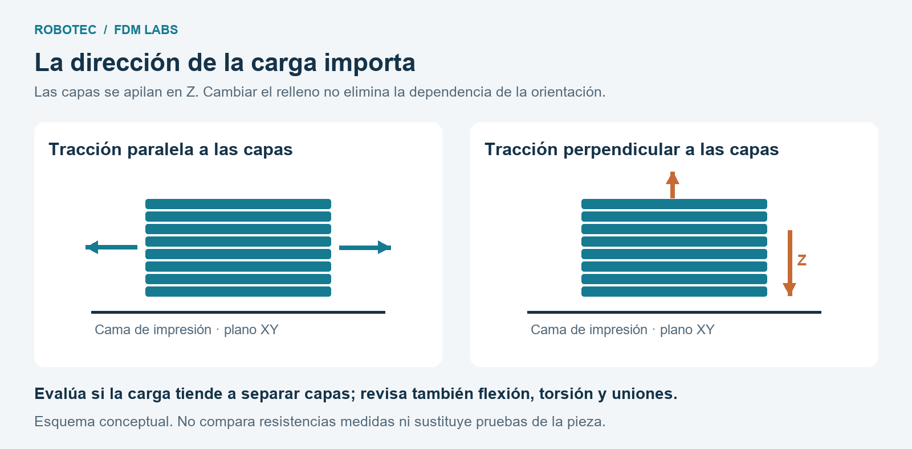

# Robotec · Templates de impresión 3D en PLA-CF

Cuatro proyectos de Bambu Studio para iniciar la configuración de piezas de robótica: desde organizadores y carcasas hasta componentes estructurales con mayores exigencias.

Cada archivo `.3mf` contiene un cubo y ajustes de impresión. **Son puntos de partida, no perfiles universales ni capacidades de carga certificadas.** La selección final depende de la geometría, orientación, material, uniones, condiciones de uso y pruebas de la pieza real.

## Elige un punto de partida



| Configuración | Paredes | Capas superiores / inferiores | Relleno | Superficie superior / inferior | Uso propuesto por el equipo |
| --- | ---: | ---: | --- | --- | --- |
| [1](Robotec_FDMLabs/Config_1.3mf) | 2 | 5 / 3 | 5% giroide | Línea monotónica / monotónica | Organizadores, carcasas y sujeciones ligeras |
| [2](Robotec_FDMLabs/Config_2.3mf) | 4 | 5 / 3 | 7% honeycomb | Línea monotónica / monotónica | Componentes pequeños con función estructural y cargas moderadas |
| [3](Robotec_FDMLabs/Config_3.3mf) | 8 | 5 / 5 | 7% honeycomb | Línea monotónica / monotónica | Candidata para piezas finales con cargas mayores |
| [Karen](Robotec_FDMLabs/Config_Karen.3mf) | 12 | 8 / 8 | 20% giroide | Curva de Hilbert / curva de Hilbert | Alternativa de mayor espesor de envolvente para evaluar en piezas exigentes |

Los valores se verificaron directamente en los cuatro archivos el **11 de noviembre de 2026**. El nombre correcto del patrón es **honeycomb** (panal de abeja), no *honeybee*. El honeycomb guardado no es el patrón *3D honeycomb*.

### Configuración 1 · Ligera y rápida

Propuesta para organizar cables, alojar electrónica y sujetar elementos con poca carga. Sus dos paredes y bajo relleno buscan reducir tiempo y consumo. No es la opción inicial recomendada para uniones críticas del robot; tampoco significa que cualquier pieza con dos paredes sea suficientemente resistente.

### Configuración 2 · Estructural ligera

Propuesta para soportes pequeños y componentes con cargas moderadas. Las cuatro paredes ofrecen más material en la envolvente que la configuración 1. Si la aplicación incluye golpes, verifica el comportamiento ante impacto: el tamaño pequeño y el número de paredes no bastan para predecirlo.

### Configuración 3 · Estructural reforzada

Sugerencia del equipo para evaluar piezas finales que reciben cargas importantes en aplicaciones habituales de robótica. Ocho paredes siguen siendo una cantidad elevada; revisa si realmente aportan una mejora útil frente a cuatro y si caben en las secciones del modelo.

### Configuración Karen · Envolvente de mayor espesor

Nombrada en reconocimiento a **Karen, creadora de la configuración**. Combina doce paredes, ocho capas superiores e inferiores y 20% de giroide. Puede ser excesiva para muchas aplicaciones y resultar útil cuando se justifica una envolvente gruesa. **No garantiza resistencia, firmeza ni aptitud para una pieza crítica:** esa conclusión requiere revisar el diseño y validar la pieza. La curva de Hilbert se conserva como elección de acabado, sin atribuirle una mejora estructural demostrada.

## Qué contienen los archivos

Los cuatro proyectos guardan los siguientes datos:

| Parámetro | Valor guardado |
| --- | --- |
| Aplicación de origen | Bambu Studio 02.07.01.62 |
| Impresora | Bambu Lab X2D |
| Perfil de impresora | `Bambu Lab X2D 0.4 nozzle` |
| Material | `Generic PLA-CF @BBL X2D 0.4 nozzle` |
| Altura de capa / primera capa | 0.20 / 0.20 mm |
| Ancho de línea exterior / interior | 0.42 / 0.45 mm |
| Espesor mínimo superior / inferior | 1.0 / 0 mm |

Estos datos describen el proyecto guardado; no acreditan pruebas de impresión ni compatibilidad con otros equipos. Un espesor mínimo inferior de 0 mm **no elimina las capas inferiores**: también está configurado su número de capas. A 0.20 mm de altura, 3, 5 y 8 capas representan nominalmente 0.60, 1.00 y 1.60 mm. Comprueba el resultado efectivo en la vista previa.

El número de paredes tampoco equivale directamente a un espesor universal: intervienen el ancho de extrusión, los solapes, la geometría y el generador de paredes. En zonas delgadas, las paredes pueden ocupar toda la sección y dejar poco o ningún relleno.

## Cómo usar un template

1. Descarga el repositorio con **Code → Download ZIP** y descomprímelo, o descarga el `.3mf` que necesites.
2. Abre el archivo **como proyecto** en Bambu Studio. Importar solamente su geometría puede omitir la configuración.
3. Guarda una copia para tu pieza. Conserva el template como referencia.
4. Confirma la impresora, boquilla, placa y filamento reales. Si cambias de equipo, usa su perfil correspondiente y vuelve a verificar los parámetros de la tabla.
5. Importa tu modelo y elimina el cubo de referencia. Revisa los ajustes globales y cualquier ajuste por objeto o modificador.
6. Orienta la pieza considerando las cargas y las uniones. Define soportes y adhesión a la cama según la geometría.
7. Lamina y revisa paredes, capas sólidas, puentes, zonas sin soporte, tiempo y masa estimados. No asumas que el nuevo modelo heredó todos los ajustes correctamente.
8. Imprime, comprueba dimensiones y ensamble, y valida el funcionamiento antes de adoptar la configuración como definitiva.

## Criterios para ajustar la configuración

### Paredes y relleno cumplen funciones distintas

En muchas piezas, aumentar los perímetros aporta más que aumentar únicamente el relleno. Sin embargo, el relleno sí influye en el soporte de las capas superiores, rigidez y comportamiento a compresión. Por ello, no debe describirse como irrelevante para la resistencia. [Prusa: Infill](https://help.prusa3d.com/article/infill_42).

El 5–7% de estos templates es una decisión inicial del equipo, no un óptimo demostrado. Si una tapa presenta hundimientos o puentes largos, evalúa aumentar el soporte interior, el relleno o las capas superiores. En zonas de tornillos y concentraciones de carga, considera refuerzos geométricos y ajustes locales en lugar de aumentar todo el modelo.

### Giroide, honeycomb y acabado superficial

- **Giroide:** opción inicial recomendada aquí para nuevas variantes. Su estructura tridimensional ofrece soporte en distintas direcciones, pero no vuelve isotrópica a toda la pieza impresa.
- **Honeycomb:** se conserva en las configuraciones 2 y 3. Es un patrón hexagonal que puede exigir más tiempo y material que otras alternativas. No se establece una superioridad general frente al giroide ni ante cargas normales a la cama: habría que comparar la pieza, orientación y modo de carga concretos.
- **Hilbert:** es el patrón de las superficies superior e inferior de Karen; su relleno interior sigue siendo giroide. La apariencia de la superficie y el relleno interior son ajustes diferentes.

Referencia: [Prusa: patrones de relleno y superficies](https://help.prusa3d.com/article/infill-patterns_177130). Sus comparaciones explican los patrones; no son ensayos de estos templates en PLA-CF. Para una comparación propia, registra masa y tiempo reales: igual porcentaje nominal no implica necesariamente igual consumo entre patrones.

### La orientación forma parte del diseño

Las piezas FDM tienen propiedades dependientes de la dirección. Elegir la orientación puede ser tan decisivo como elegir paredes y relleno. [Prusa: diseño para impresión 3D](https://help.prusa3d.com/article/modeling-with-3d-printing-in-mind_164135).



*Esquema conceptual, no simulación ni resultado de ensayo. Z es perpendicular a la cama; XY es paralelo a ella.*

Evita, cuando el diseño lo permita, que la tracción principal tienda a separar las capas. Revisa también flexión, torsión, impactos y puntos de fijación. Más paredes no corrigen por sí solas una orientación desfavorable o una mala unión entre capas.

### PLA-CF: verifica el producto concreto

PLA-CF es PLA con fibra de carbono; sus propiedades dependen de la formulación y del proceso. No extrapoles automáticamente los valores de una marca a otra ni confundas rigidez con resistencia al impacto.

Consulta la ficha técnica del filamento para temperatura, secado, límite térmico y compatibilidad de boquilla. Como referencia de fabricante, Bambu indica boquilla de acero endurecido para su PLA-CF; esto no sustituye las indicaciones del material utilizado. [Bambu Lab: guía de filamentos](https://cdn1.bambulab.com/filament/filament-guide/bcv8wbl4hj/filament-guide-en.pdf).

Para piezas próximas a motores, expuestas al calor o sometidas a carga sostenida, evalúa la temperatura de servicio y la deformación con el tiempo. Si el material no es adecuado, aumentar paredes o relleno no resuelve la selección del material.

## Validación y mejora continua

**Estado inicial:** se verificaron los parámetros de los archivos, pero este repositorio no incluye ensayos mecánicos, cargas admisibles, factores de seguridad ni comparaciones medidas de consumo. Los usos sugeridos proceden de la experiencia y propuesta del equipo.

Antes de aprobar una pieza funcional:

- Define las cargas, temperatura, duración de uso y consecuencias de falla.
- Revisa orientación, dimensiones, holguras, tornillos e insertos.
- Inspecciona defectos de impresión y prueba en condiciones representativas.
- Establece criterios de aceptación medibles y registra el resultado.
- Compara variantes cambiando un parámetro a la vez cuando sea posible.

Usa la [ficha de validación](docs/VALIDACION.md) para conservar la evidencia. En piezas críticas, la revisión y los ensayos deben corresponder al riesgo real de la aplicación.

## Estructura del repositorio

```text
robotec-fdm-templates/
├── README.md
├── Robotec_FDMLabs/
│   ├── Config_1.3mf
│   ├── Config_2.3mf
│   ├── Config_3.3mf
│   └── Config_Karen.3mf
└── docs/
    ├── GITHUB_PRIMEROS_PASOS.md
    ├── VALIDACION.md
    └── figures/
        ├── configuraciones.png
        └── orientacion.png
```

¿Es tu primer repositorio? Sigue la [guía para publicarlo en GitHub](docs/GITHUB_PRIMEROS_PASOS.md).

## Créditos y contribuciones

Configuración Karen: reconocimiento a Karen por su configuración original. Configuraciones 1–3 y criterios de uso: propuesta de mejora continua de Robotec.

Para proponer cambios, incluye el motivo, los parámetros modificados y, cuando existan, fotos y resultados de impresión o ensayo. Conserva las variantes experimentales separadas de los templates base hasta evaluarlas.

La licencia de distribución queda pendiente de elección por los responsables del material.

## Referencias

Consultadas el 11 de noviembre de 2026. Las fuentes respaldan criterios generales, no certifican estos proyectos.

1. [Prusa — Infill](https://help.prusa3d.com/article/infill_42).
2. [Prusa — Infill patterns](https://help.prusa3d.com/article/infill-patterns_177130).
3. [Prusa — Modeling with 3D printing in mind](https://help.prusa3d.com/article/modeling-with-3d-printing-in-mind_164135).
4. [Bambu Lab — Filament Guide](https://cdn1.bambulab.com/filament/filament-guide/bcv8wbl4hj/filament-guide-en.pdf).
